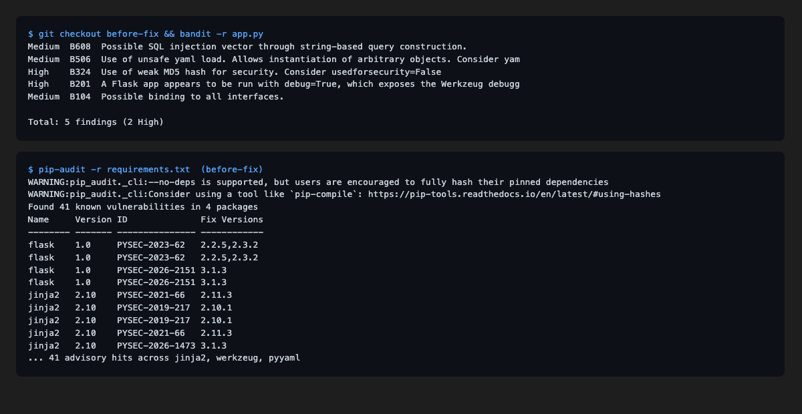
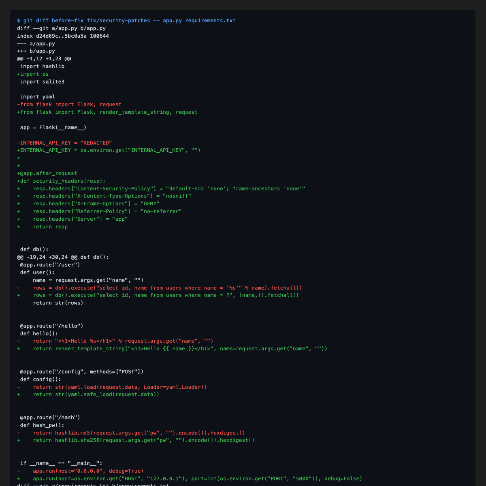

# DevSecOps CI/CD Security Pipeline

**Problem:** vulnerabilities reach production because security checks happen late. This repo runs four automated security gates on every pull request and fails the build on High/Critical findings.

```
PR -> SAST (Semgrep, Bandit) -> SCA (Trivy) -> Secrets (Gitleaks) -> DAST (OWASP ZAP) -> merge
```

Pipeline: [.github/workflows/security.yml](.github/workflows/security.yml)

| Gate | Tool | Fails on |
|---|---|---|
| SAST | Semgrep, Bandit | any Semgrep finding, Bandit High |
| SCA | Trivy | High/Critical dependency CVEs with a fix |
| Secrets | Gitleaks | any detected secret (full history) |
| DAST | ZAP baseline | rules in `.zap/rules.tsv` (missing CSP, clickjacking, nosniff) |

## Before vs after
The `before-fix` tag is the intentionally vulnerable app; `main` is the patched version. Diff: [docs/fix.diff](docs/fix.diff).

| Weakness | Before | After |
|---|---|---|
| SQL injection | string-formatted query | parameterised query |
| Reflected XSS | raw input in HTML | Jinja autoescaped template |
| Unsafe deserialisation | `yaml.load` | `yaml.safe_load` |
| Weak hash | MD5 | SHA-256 |
| Hardcoded secret | key in source | read from `INTERNAL_API_KEY` env var |
| Debug mode / bind all | `debug=True`, `0.0.0.0` | off / `127.0.0.1` (container sets `HOST`) |
| Vulnerable deps | Flask 1.0, Jinja2 2.10, Werkzeug 0.15.0, PyYAML 5.3 (~30 advisories) | pinned current versions, 0 known |
| Missing headers | none | CSP, nosniff, X-Frame-Options, Referrer-Policy |

Bandit: 5 findings (2 High) -> 0. pip-audit: ~30 advisories -> 0.





Reports: [before_bandit.txt](docs/before_bandit.txt), [after_bandit.txt](docs/after_bandit.txt), [before_sca.txt](docs/before_sca.txt), [after_sca.txt](docs/after_sca.txt).

## Reproduce
```bash
pip install bandit pip-audit
git checkout before-fix && bandit -r app.py && pip-audit -r requirements.txt --no-deps --disable-pip
git checkout main      && bandit -r app.py && pip-audit -r requirements.txt --no-deps --disable-pip
```
To see the gates in GitHub: push `before-fix` as a branch, open a PR to `main` (red build), then merge the fix (green build). Semgrep, Trivy, Gitleaks and ZAP run in CI only; Semgrep has no Intel-Mac build.

Resume bullet: *Built a GitHub Actions DevSecOps pipeline (Semgrep, Bandit, Trivy, Gitleaks, ZAP) gating every PR; remediated 5 SAST findings and ~30 dependency CVEs, taking scan results to zero.*
