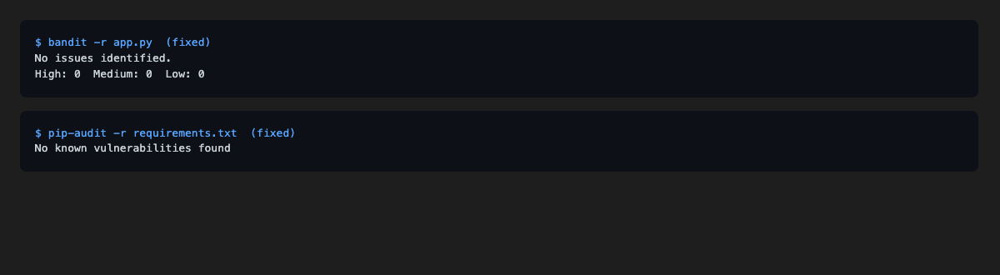
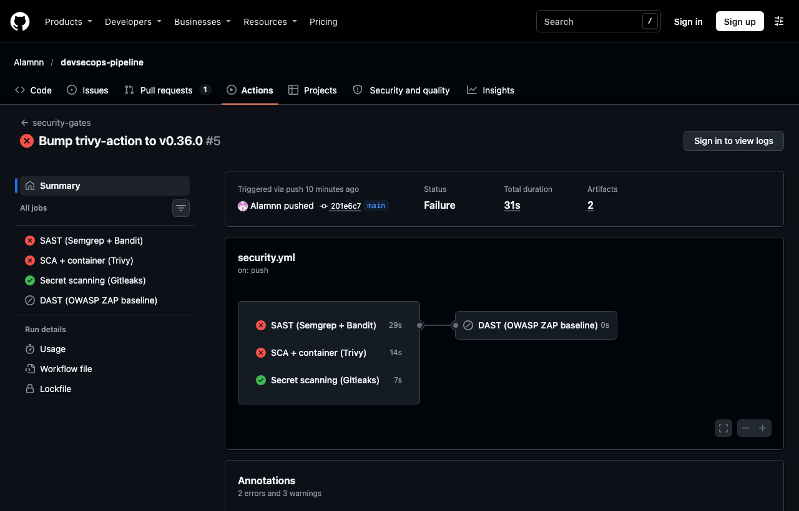
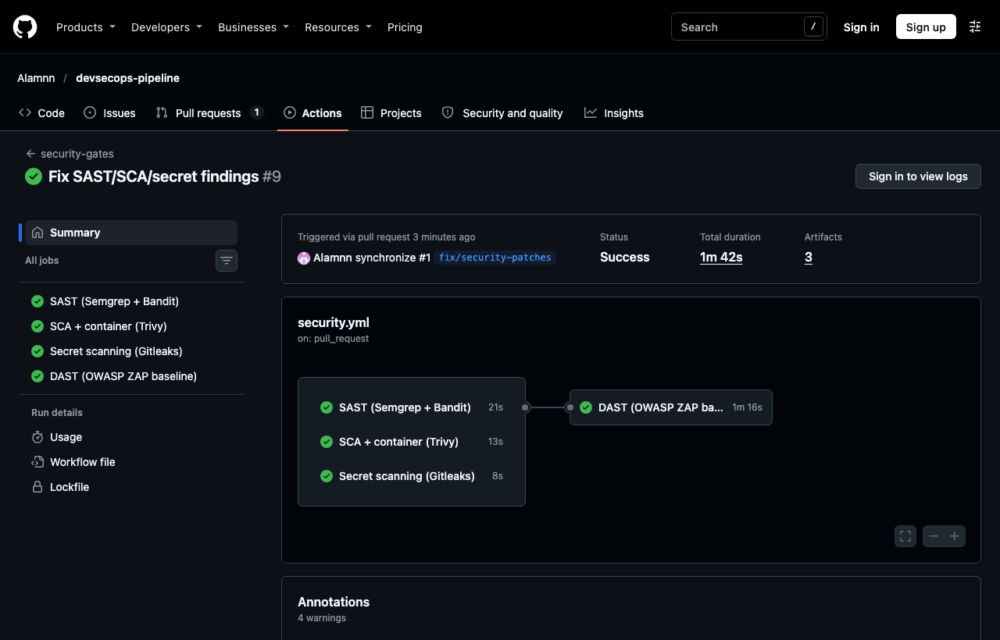

# DevSecOps CI/CD Security Pipeline

## Why I built this
Most vulnerabilities that make it to production are easy to catch early if the build pipeline refuses to merge them. I built this project to show how a practical four-stage security gate works in GitHub Actions on every pull request, without slowing developers down on fast static checks.

I started by writing an intentionally vulnerable Flask application (`app.py`, tagged `before-fix` on `main`) containing SQL injection, reflected Cross-Site Scripting (XSS), unsafe YAML deserialization, weak MD5 password hashing, a hardcoded API key, debug mode enabled, missing HTTP security headers, and outdated dependencies with roughly 30 known CVEs. Then I wired up `.github/workflows/security.yml` to fail the build on High or Critical findings, patched every issue on a pull request branch (`fix/security-patches`), and verified that the pipeline goes from red on `main` to green on PR #1.

```text
Push / PR -> [SAST: Semgrep + Bandit] + [SCA: Trivy] + [Secrets: Gitleaks] -> [DAST: OWASP ZAP Baseline]
```

## What each pipeline gate checks
The workflow is defined in [.github/workflows/security.yml](.github/workflows/security.yml). The three static jobs run in parallel first; the live container DAST job runs only after the static jobs pass (`needs: [sast, sca, secrets]`).

| Stage | Tooling | What it catches in this repo | Failure threshold |
|---|---|---|---|
| **1. SAST** | Semgrep (`p/python`, `p/owasp-top-ten`) + Bandit | SQL injection (`B608`), unsafe `yaml.load` (`B506`), weak MD5 (`B324`), Flask `debug=True` (`B201`), manual HTML string formatting (`raw-html-format`) | Any Semgrep error or Bandit High severity (`-lll`) |
| **2. SCA** | Trivy (`aquasecurity/trivy-action@v0.36.0`) + `pip-audit` | ~30 CVEs across `flask==1.0`, `jinja2==2.10`, `werkzeug==0.15.0`, and `pyyaml==5.3` | Any High or Critical CVE with an available fix |
| **3. Secrets** | Gitleaks (`gitleaks/gitleaks-action@v2`) | Hardcoded `INTERNAL_API_KEY` across full git history (`fetch-depth: 0`) | Any leaked credential or API token |
| **4. DAST** | OWASP ZAP Baseline (`zaproxy/action-baseline@v0.15.0`) | Missing `Content-Security-Policy` (including `form-action` and `base-uri`), missing `X-Frame-Options`, missing `X-Content-Type-Options`, missing `Permissions-Policy`, missing `COEP`, and server version leaks | Any rule marked `FAIL` or `WARN` in [.zap/rules.tsv](.zap/rules.tsv) |

## What I fixed between `before-fix` and `main`
Full code diff: [docs/fix.diff](docs/fix.diff).

1. **SQL Injection (`/user`)**: Replaced `%s` string interpolation with a parameterized SQLite query (`SELECT id, name FROM users WHERE name = ?`, `(name,)`).
2. **Reflected XSS (`/hello`)**: My first patch used `markupsafe.escape()` inside a `%` formatted string. Bandit passed, but Semgrep still failed the build (`directly-returned-format-string`) because manual HTML string concatenation is fragile. Switching to `render_template_string("<h1>Hello {{ name }}</h1>", name=...)` uses Jinja2 autoescaping and satisfied Semgrep.
3. **Unsafe Deserialization (`/config`)**: Replaced `yaml.load(request.data, Loader=yaml.Loader)` with `yaml.safe_load(request.data)`.
4. **Weak Hashing (`/hash`)**: Replaced `hashlib.md5()` with `hashlib.sha256()`.
5. **Hardcoded Secret**: Removed the literal key from `app.py` and loaded it from `os.environ.get("INTERNAL_API_KEY", "")`.
6. **Vulnerable Dependencies (`requirements.txt`)**: Upgraded to `flask==3.1.3`, `werkzeug==3.1.9`, `jinja2==3.1.6`, `pyyaml==6.0.2`, `markupsafe==3.0.2`, and `gunicorn==23.0.0`, dropping `pip-audit` and Trivy findings from ~30 advisories to 0.
7. **DAST Hardening (`@app.after_request` & Gunicorn)**: Served the container via Gunicorn instead of the Werkzeug dev server and added strict `Content-Security-Policy` (`default-src 'none'; frame-ancestors 'none'; form-action 'none'; base-uri 'none'`), `X-Content-Type-Options: nosniff`, `X-Frame-Options: DENY`, `Referrer-Policy: no-referrer`, `Permissions-Policy`, and Cross-Origin isolation headers (`COEP`, `COOP`, `CORP`).

## Visual proof

### Local SAST & SCA scans (before vs. after) and remediation diff




### Live GitHub Actions runs (failing `main` baseline vs. passing PR #1)



Raw scan outputs: [docs/before_bandit.txt](docs/before_bandit.txt), [docs/after_bandit.txt](docs/after_bandit.txt), [docs/before_sca.txt](docs/before_sca.txt), [docs/after_sca.txt](docs/after_sca.txt).

## How to reproduce locally
```bash
pip install bandit pip-audit

# Scan the vulnerable baseline tag
git checkout before-fix
bandit -r app.py
pip-audit -r requirements.txt --no-deps --disable-pip

# Scan the remediated branch
git checkout main
bandit -r app.py
pip-audit -r requirements.txt --no-deps --disable-pip
```
